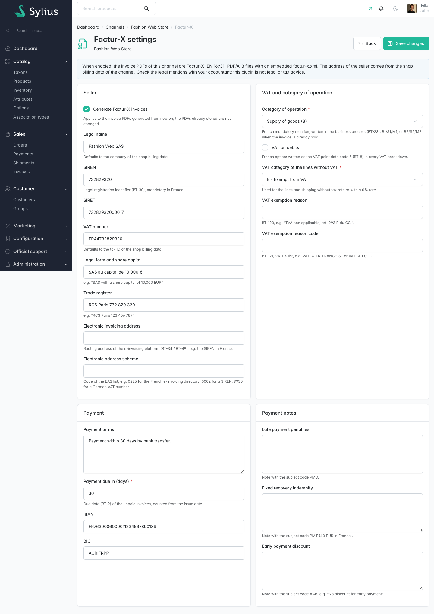
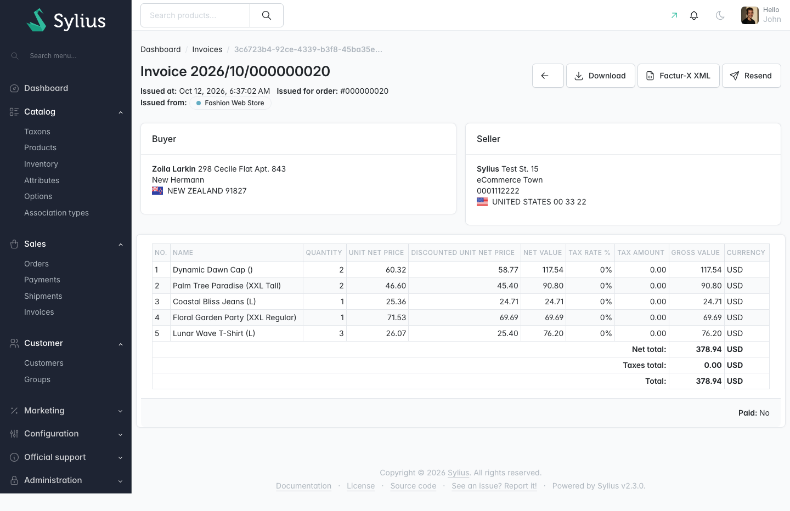

# Sylius Factur-X Plugin

> Français : [README.fr.md](README.fr.md) <!-- vitrine:lang -->

[](https://github.com/thibmonier/sylius-facturx-plugin/actions/workflows/build.yaml)
[](LICENSE)

**Factur-X / ZUGFeRD (EN 16931) electronic invoices for the Sylius 2 Invoicing Plugin.**

The official [Sylius Invoicing Plugin](https://github.com/Sylius/InvoicingPlugin) generates PDF
invoices. Since September 2026, French businesses must be able to receive electronic invoices,
and large and mid-sized companies must issue them (SMEs from September 2027); German businesses
must accept them since 2025. A plain PDF is not an electronic invoice.

This plugin turns the invoice PDFs into **Factur-X PDF/A-3 files with an embedded
`factur-x.xml`** (UN/CEFACT Cross Industry Invoice, **EN 16931** profile), the hybrid format
accepted in France and in Germany (where it is called ZUGFeRD), free and open source.

## Features

| Need | What the plugin does |
|---|---|
| Issue e-invoices without changing the invoicing flow | The PDF rendered by the Invoicing Plugin becomes a **PDF/A-3 with `factur-x.xml`** and the Factur-X XMP metadata, before it is stored: the existing admin and shop download links serve it. |
| A machine-readable invoice that adds up | XML at the **EN 16931 (COMFORT)** profile: lines with net and gross prices, item discounts, shipping as a line, multi-rate VAT breakdown, totals that reconcile to the cent with the PDF. |
| Hand the XML to an accountant or a platform | **Factur-X XML** download button on the admin invoice page, in the invoices grid and in the invoices of the order page. |
| Legal data of the seller | **Factur-X settings per channel**: legal name, SIREN, SIRET, VAT number, legal form and share capital, trade register, electronic address, payment terms and due date, IBAN / BIC, payment notes. SIREN, SIRET and French VAT numbers are checked (Luhn, VAT key). |
| French 2026 mentions | Category of operation and payment state in the business process (BT-23: `B1`, `S2`, `M1`...), seller and buyer SIREN, delivery address when different, VAT on debits option (BT-8), notes `PMT` / `PMD` / `AAB`. |
| B2B customers | Optional **B2B identifiers** card on the admin customer page: company name, SIREN, VAT number, electronic address. |
| VAT exemptions | Category used for the lines without VAT (exempt, zero rated, reverse charge, intra-community, export, not subject to VAT) with the exemption reason and VATEX code. |
| Install on a running shop | `tmonier:facturx:regenerate-pdfs` renders the stored invoice PDFs again as Factur-X. |
| Send invoices to a *plateforme agréée* | Not included: the `tmonier_facturx.invoice_generated` event gives a connector the XML and the PDF. |

Also included: translations in English, French, German, Spanish, Italian, Dutch and Polish;
Twig Hooks everywhere; MySQL, MariaDB and PostgreSQL support.

## Screenshots





## Requirements

| | Version |
|---|---|
| PHP | 8.2+ (ext-dom, ext-gd, ext-zip, ext-fileinfo) |
| Sylius | 2.2, 2.3 |
| Symfony | 6.4, 7.4, 8.0 |
| [sylius/invoicing-plugin](https://github.com/Sylius/InvoicingPlugin) | 2.2+, with PDF generation enabled |

The PDF of the Invoicing Plugin must be readable by the free FPDI parser (no compressed
cross-reference streams): this is the case of PDFs rendered by wkhtmltopdf, the default
renderer. The plugin depends on [horstoeko/zugferd](https://github.com/horstoeko/zugferd) (MIT),
which itself requires `smalot/pdfparser` (LGPL-3.0, installed by Composer, not bundled).

## Installation

1. Install and configure the [Sylius Invoicing Plugin](https://github.com/Sylius/InvoicingPlugin#installation)
   first (bundles, configuration, routes, migrations, wkhtmltopdf).

2. Require the package:

    ```bash
    composer require tmonier/sylius-facturx-plugin
    ```

3. Register the bundle in `config/bundles.php`, after the Invoicing Plugin:

    ```php
    Sylius\InvoicingPlugin\SyliusInvoicingPlugin::class => ['all' => true],
    Tmonier\SyliusFacturXPlugin\TmonierSyliusFacturXPlugin::class => ['all' => true],
    ```

4. Import the configuration in `config/packages/tmonier_sylius_facturx.yaml`:

    ```yaml
    imports:
        - { resource: "@TmonierSyliusFacturXPlugin/config/config.yaml" }
    ```

5. Import the admin routes in `config/routes/tmonier_sylius_facturx.yaml`:

    ```yaml
    tmonier_sylius_facturx:
        resource: "@TmonierSyliusFacturXPlugin/config/routes.yaml"
    ```

6. Run the migrations:

    ```bash
    bin/console doctrine:migrations:migrate
    ```

7. In the admin, open **Channels → (edit a channel) → Factur-X settings**, enable Factur-X and
   fill in the seller data. The address of the seller comes from the **shop billing data** of
   the channel (company, tax ID, street, postcode, city, country): fill it in too.

8. Optionally, render the PDFs of the invoices issued before as Factur-X:

    ```bash
    bin/console tmonier:facturx:regenerate-pdfs --dry-run -v
    bin/console tmonier:facturx:regenerate-pdfs [--channel=WEB] [--invoice=2026/10/000001]
    ```

## Configuration

```yaml
# config/packages/tmonier_sylius_facturx.yaml
tmonier_sylius_facturx:
    enabled: true                         # global switch; each channel must be enabled too
    profile: en16931                      # the only supported profile
    attachment_relationship: Alternative  # AFRelationship of factur-x.xml: Alternative, Data or Source
```

`Alternative` is required in Germany for the EN 16931 profile and accepted in France.

The `ChannelSettings` and `CustomerIdentifiers` resources can be extended like any Sylius
resource (`tmonier_sylius_facturx.resources.channel_settings.classes.model`, ...).

## What ends up in the XML

| Invoice data | Factur-X |
|---|---|
| Invoice number, issue date, currency, order number | BT-1, BT-2, BT-5, BT-14 |
| Seller: legal name, SIREN, SIRET, VAT number, legal form + trade register, address | BT-27, BT-30 (scheme 0002), BT-29 (0009), BT-31, BT-33, BG-5 |
| Buyer: billing company or name, address, B2B identifiers | BT-44, BG-8, BT-47, BT-48, BT-49 |
| Shipping address, when different from the billing address | BG-15 |
| Last shipping date of the order (nothing while no shipment is shipped) | BT-72 |
| Lines: product (or shipping method), variant code, quantity, gross and net unit price, net amount, VAT category and rate | BG-25 |
| VAT breakdown per category and rate | BG-23 |
| Totals, amount paid, amount due, due date (channel settings or a payment terms provider) | BG-22, BT-9 |
| IBAN / BIC, payment terms (channel settings or a payment terms provider), notes | BG-16, BT-20, BT-22 |

The amounts are the ones of the invoice: Sylius rounds the VAT per unit, so a VAT amount may
differ by a few cents from *taxable amount × rate*, which EN 16931 allows. The full mapping,
the French rules and the sources are in [SPEC.md](SPEC.md).

## Extension point: per-order payment terms

By default the due date (BT-9) is the issue date plus the channel's *payment due days* when an
amount is due, and the payment terms (BT-20) are the channel's *payment terms* text. A plugin
that knows better for some orders (e.g. trade credit: "45 days end of month", per-customer
terms) provides them with an `InvoicePaymentTermsProviderInterface`:

```php
use Sylius\InvoicingPlugin\Entity\InvoiceInterface;
use Symfony\Component\DependencyInjection\Attribute\AsTaggedItem;
use Tmonier\SyliusFacturXPlugin\Entity\ChannelSettingsInterface;
use Tmonier\SyliusFacturXPlugin\PaymentTerms\InvoicePaymentTerms;
use Tmonier\SyliusFacturXPlugin\PaymentTerms\InvoicePaymentTermsProviderInterface;

#[AsTaggedItem(priority: 10)]
final class TradeCreditPaymentTermsProvider implements InvoicePaymentTermsProviderInterface
{
    public function provide(InvoiceInterface $invoice, ChannelSettingsInterface $settings, int $duePayableAmount): ?InvoicePaymentTerms
    {
        $terms = $this->termsRepository->findOneByOrder($invoice->order());
        if (null === $terms) {
            // $duePayableAmount (cents) is 0 for a paid invoice: the due date is then dropped.
            return null; // next provider, then the channel settings
        }

        return new InvoicePaymentTerms($terms->getDueDate(), $terms->getLabel());
    }
}
```

Autoconfigured services get the `tmonier_facturx.invoice_payment_terms_provider` tag (set
`priority` on the tag or with `#[AsTaggedItem]`, highest first). The first provider returning
terms wins; the channel settings apply when none does. When an amount is due, terms with
neither due date nor text are skipped, so the XML always satisfies BR-CO-25. Paid invoices
(nothing due) never get a due date (BT-9), whatever the provider returns; its text is kept. The aggregate is available as
`InvoicePaymentTermsProviderInterface` (`tmonier_facturx.payment_terms_provider`).

## Extension point: transmission to a platform

```php
use Tmonier\SyliusFacturXPlugin\Event\FacturXInvoiceGenerated;

#[AsEventListener(event: FacturXInvoiceGenerated::NAME)]
final class SendToMyPlatform
{
    public function __invoke(FacturXInvoiceGenerated $event): void
    {
        $event->getInvoice();      // Sylius\InvoicingPlugin\Entity\InvoiceInterface
        $event->getXml();          // factur-x.xml
        $event->getPdfContent();   // Factur-X PDF/A-3
        $event->getPdfFilename();  // file name in the "sylius_invoicing" storage
    }
}
```

The event is dispatched every time the PDF is rendered, before it is stored, including when it
is rendered again: listeners must be idempotent (use the invoice id). A failing listener is
logged and does not prevent the invoice.

## Customisation

| Hook | Content |
|---|---|
| `sylius_admin.invoice.show.content.header.title_block.actions` → `tmonier_facturx_download_xml` | XML download button of the invoice page |
| `sylius_admin.order.show.content.sections.invoices.table.body.actions` → `tmonier_facturx_download_xml` | XML download in the invoices of the order page |
| `sylius_admin.channel.update.content.header.title_block.actions` → `tmonier_facturx_settings` | Link to the Factur-X settings |
| `sylius_admin.customer.show.content.sections` → `tmonier_facturx_identifiers` | B2B identifiers card |
| `tmonier_facturx.admin.channel.settings` / `tmonier_facturx.admin.customer.identifiers` | Settings pages (sections `seller`, `vat`, `payment`, `notes`) |

Grid actions are added to `sylius_admin_channel` (`tmonier_facturx`) and
`sylius_invoicing_invoice` (`tmonier_facturx_xml`). Services can be decorated:
`tmonier_facturx.mapper.invoice` (invoice → data), `tmonier_facturx.xml.writer` (data → XML),
`tmonier_facturx.pdf.embedder` (PDF + XML → PDF/A-3).

The XML download route (`tmonier_facturx_admin_invoice_download_xml`) checks
`InvoiceVoter::ACCESS` (from `sylius/invoicing-plugin`) before serving the file, mirroring the
access control applied to the core PDF download (`DownloadInvoiceAction`).

## Limitations

- **No transmission to a *plateforme agréée* (PA)** and no e-reporting: in France, issuing an
  e-invoice means sending it through a PA. Use the event above to build a connector.
- **EN 16931 profile only**. No credit notes (the Invoicing Plugin has none), no down-payment
  invoices, no document-level allowances or charges (Sylius distributes promotions on the
  lines).
- Buyer identifiers are optional and entered by an administrator on the customer page; they
  are not captured at checkout. B2C invoices are valid Factur-X documents, but in France B2C
  sales are e-reported, not e-invoiced.
- Invoices issued before shipping carry no delivery date (BT-72): the delivery group of the XML
  is then empty, which validators report as the PEPPOL-EN16931-R008 warning (not an error).
- Every line with a positive VAT rate is category S; all lines without VAT share the one
  category configured on the channel.
- The PDF/A-3 conformance of the result depends on the PDF rendered by the Invoicing Plugin:
  the plugin adds the attachment, the XMP metadata and the output intent, and corrects the
  glyph widths of the embedded TrueType fonts (wkhtmltopdf writes them about 0.7 % too small,
  which veraPDF rejects), but it does not rewrite the pages. With the default template and
  wkhtmltopdf 0.12.6 the result passes veraPDF (PDF/A-3B); check a sample of your own template
  with a validator (see *Development*).
- Already stored PDFs are not changed until you run `tmonier:facturx:regenerate-pdfs`.
- If the Factur-X document cannot be built (missing seller data, unreadable PDF), the plain PDF
  is kept and the error is logged on the `tmonier_facturx` channel.

**This plugin is not legal or tax advice.** It produces a technically valid document from the
data you enter and the taxes Sylius computes. The legal mentions, VAT rates, categories and
exemption reasons, the buyer data and the choice of a PA remain the merchant's responsibility:
check them with your accountant.

## Development

```bash
docker compose up -d mysql mailhog   # or your own MySQL
composer install
(cd vendor/sylius/test-application && yarn install && yarn build)
vendor/bin/console doctrine:database:create
vendor/bin/console doctrine:migrations:migrate -n
vendor/bin/console sylius:fixtures:load -n

vendor/bin/phpunit --testsuite unit
APP_ENV=test vendor/bin/phpunit --testsuite non-unit   # needs a test database with fixtures
vendor/bin/phpstan analyse
vendor/bin/ecs check
```

**Placeholder PDFs**: when `WKHTMLTOPDF_PATH` does not point to an executable wkhtmltopdf, the
test application (dev and test environments) renders every invoice as a one-page FPDF
placeholder (*Invoice 2026/10/000001*), which still becomes a valid Factur-X PDF. To see the
real invoices without installing wkhtmltopdf, use the Docker wrapper (wkhtmltopdf 0.12.6 with
patched Qt), then clear the cache and render the stored PDFs again:

```bash
echo "WKHTMLTOPDF_PATH=$PWD/tests/TestApplication/bin/wkhtmltopdf-docker" >> tests/TestApplication/.env.local
rm -rf var/cache/dev var/cache/test
vendor/bin/console tmonier:facturx:regenerate-pdfs
```

The tests validate every generated XML against the
Factur-X EN 16931 XSD and re-compute the EN 16931 calculation rules in PHP. The functional tests
write `etc/build/factur-x.pdf` and `etc/build/factur-x.xml` (and, with a real wkhtmltopdf,
`etc/build/factur-x-wkhtmltopdf.pdf`); the CI renders a real invoice and validates them with
[Mustang](https://www.mustangproject.org/commandline/) (EN 16931 schematron and veraPDF):

```bash
java -jar Mustang-CLI-2.26.0.jar --no-notices --action validate --source etc/build/factur-x.pdf
```

<!-- vitrine:demo-b2b:start -->
## B2B demo

This plugin is used in the [Sylius B2B demo](https://github.com/thibmonier/sylius-b2b-demo): a Sylius 2.3 shop with fictitious sample data where the B2B plugins work together. The source code, setup and fixtures of the demo are in that repository.

The demo is an example, not a production setup.
<!-- vitrine:demo-b2b:end -->

## License

MIT. See [LICENSE](LICENSE).
